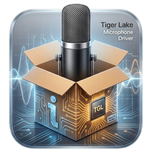

<p align="center">
  
</p>

<h1 align="center">TGLDmic</h1>
<p align="center"><b>Tiger Lake microphone driver for macOS</b><br>
Internal digital microphones (DMIC) of Intel Tiger Lake laptops via the Intel Smart Sound DSP (SOF)</p>

> Unofficial community project. Not affiliated with or endorsed by Intel, Apple or any laptop vendor.

On many Tiger Lake laptops the built-in microphones are not wired to the HDA codec but to the
Smart Sound DSP, so AppleALC cannot make them work and hackintoshes end up without an internal mic.
TGLDmic boots Intel's SOF firmware on that DSP and exposes the mics to macOS as a normal input device,
**Internal Microphone (TGLDmic)**. It runs next to AppleHDA/AppleALC, which keep speakers and headset.

## Features
- Standard Core Audio input device: shows up in System Settings and any recording app (tested: Voice Memos, QuickTime)
- Stereo 48 kHz, input gain 0–36 dB via the macOS input volume slider
- DSP is powered only while something records (~120 ms start-up)
- Repeated recording sessions; coexists with AppleHDA/AppleALC
- Installer package for the Core Audio plug-in that checks the kext version first

## Compatibility
| | |
|---|---|
| Supported | Intel Smart Sound DSP `8086:A0C8`: Tiger Lake **LP** (11th-gen Core, UP3/UP4) |
| Not supported | Tiger Lake-H `8086:43C8`, Ice Lake and older, Alder Lake and newer |
| Tested | HP EliteBook 840 G8 (4 PDM mics, ALC285): macOS Ventura (AppleALC) and Tahoe (HDAUniversal) |
| Other Tiger Lake laptops | Expected to work with a 2- or 4-mic PDM array; **untested**, reports welcome |
| macOS | Ventura and Tahoe tested; Sonoma (AppleALC) and Sequoia (HDAUniversal) expected to work |
| Audio driver | Works next to **AppleALC/AppleHDA** or **HDAUniversal** (speakers and headset stay with them) |

> **Device-id spoof:** OpenCore configs usually spoof the audio controller as `34C8` for AppleALC.
> TGLDmic matches that too, then checks the real PCI ID and only attaches to a genuine `A0C8`.

## Install
Download both files from [Releases](../../releases):

| File | What |
|---|---|
| `TGLDmic-<version>-kext.zip` | `TGLDmic.kext` for OpenCore + test tools |
| `TGLDmic-<version>.pkg` | Installer for the Core Audio plug-in |

1. Add `TGLDmic.kext` to `EFI/OC/Kexts` and to `Kernel > Add` in `config.plist`, **after AppleALC**.
2. Add `-tgldmic` to `boot-args` and reboot.
3. Run `TGLDmic-<version>.pkg`. It checks that the matching kext is loaded before installing.
4. Pick **Internal Microphone (TGLDmic)** under **System Settings → Sound → Input**.

Full steps, troubleshooting and removal: [docs/INSTALL.md](docs/INSTALL.md).

## How it works
```
 Apps ─▶ Core Audio ─▶ TGLDmic.driver (HAL plug-in) ─▶ TGLDmic.kext ─▶ Smart Sound DSP (SOF) ─▶ PDM mics
                         ring buffer + timestamps      boots firmware,      capture pipeline
                                                       sets up DMA          DMIC0 → PCM
```
The kext loads the Intel-signed SOF firmware into the DSP, replays the IPC messages Linux uses to
build the DMIC capture pipeline, and streams the audio into a ring buffer by DMA. The HAL plug-in
maps that ring and presents it to Core Audio. Details: [docs/ARCHITECTURE.md](docs/ARCHITECTURE.md).

## Your laptop is not working?
The pipeline setup is recorded from the reference machine. If the mic stays silent on your laptop:
1. Boot an Ubuntu live USB and run `sudo bash linux/capture-sof-dmic.sh`. It records no audio into the tarball.
2. Open an issue with the tarball and `ioreg -l -w0 -c TGLDmic` from macOS.

Debug boot args and test procedures: [docs/TESTING.md](docs/TESTING.md).

## Building
GitHub Actions builds both files on every push, and attaches them to a Release for `v*` tags.
Locally on macOS with Xcode command-line tools and [MacKernelSDK](https://github.com/acidanthera/MacKernelSDK):

    make -C kext SDK=/path/to/MacKernelSDK
    make -C hal

`tools/set-version.sh X.Y.Z` sets the version in every place.

| Path | What |
|---|---|
| `kext/` | Kernel driver `TGLDmic.kext` |
| `hal/` | Core Audio plug-in `TGLDmic.driver`, `tgldmic-probe` |
| `pkg/` | Installer package sources |
| `firmware/` | Intel-signed SOF firmware embedded in the kext |
| `linux/` | Capture tool and IPC extractor |
| `captures/` | Reference captures (logs, NHLT, topology; no audio) |
| `tools/` | Build and diagnostic helpers |
| `docs/` | Install, testing, architecture |

## Credits
- [Sound Open Firmware](https://github.com/thesofproject) — the DSP firmware and the Linux driver this work is based on
- [acidanthera](https://github.com/acidanthera) — MacKernelSDK, OpenCore, AppleALC

## Licence
TGLDmic is BSD-3-Clause ([LICENSE](LICENSE)). The embedded SOF firmware is Intel's, redistributed
unmodified under [firmware/LICENCE.Intel](firmware/LICENCE.Intel).
